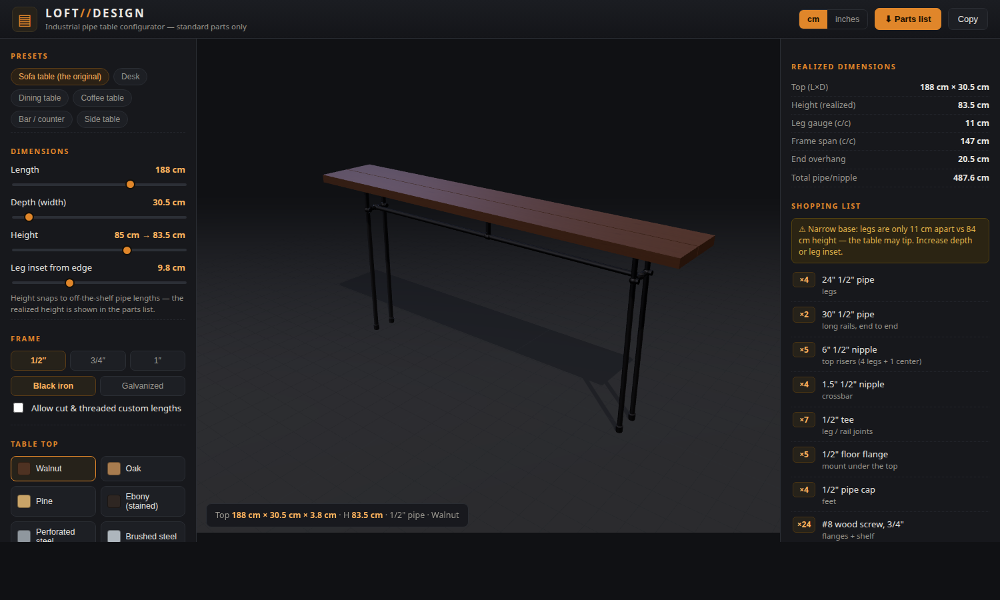

# LOFT//DESIGN — Industrial Pipe Table Configurator

A parametric 3D configurator for the DIY industrial pipe table from
[temptingthyme.com](https://temptingthyme.com/2015/02/11/diy-industrial-pipe-table/),
built entirely from **standard, off-the-shelf plumbing parts**.



## Run it

```bash
python3 -m http.server 4173 --bind 0.0.0.0
# open http://127.0.0.1:4173
# from other devices on the LAN: http://<machine-ip>:4173  (e.g. http://192.168.1.7:4173)
```

(Any static file server works; there is no build step. `npm start` does the same.)

## What it does

- **3D view** (three.js, orbit/zoom/pan, turntable toggle) of the exact frame from the blog:
  2 end frames (cap → leg → tee → riser → floor flange), crossbar between the leg tees,
  2 long rails joined by a middle tee whose riser + 5th flange carry the center of the top.
- **Dimensions**: length / depth / height / leg inset. The solver *snaps heights to stock
  pipe lengths* (trying every riser × leg combination) and reports the **realized** height.
- **Table top**: walnut, oak, pine, ebony stain, **perforated steel plate** (real hole grid)
  or brushed steel. Wood renders as planks with seams, like the original 2-plank top.
- **Frame**: 1/2″, 3/4″ or 1″ pipe, black iron or galvanized.
- **Accessories**: casters (replace feet caps), hang rail under the top (+2 flanges, +2 tees),
  lower storage shelf (+4 tees, +2 support rails).
- **Shopping list**: live bill of materials with stock sizes (`24"`, `6"`…), cut-to-length
  flags, total pipe length, warnings (tippy narrow base, rails vs top length…), plus
  **download / copy** as text.
- **CAD plan** (▦ button): generates a printable 2-sheet A4-landscape drawing set —
  sheet 1: front / side / plan views with dimension lines + live isometric render,
  sheet 2: every part as a 2D cut-sheet drawing; title block, notes, print/save-as-PDF.
  Extra part pages are added automatically for big configurations.
- **Shareable URLs**: `?preset=dining&top=perf&acc=shelf,casters,hangrail&units=in&rotate=0`
  (also `L`, `D`, `H`, `li` in cm, `pipe=3/4`, `finish=galv`, `cut=1`). Unknown or invalid
  parameter values are ignored and the default is used, so old links keep working.

## Fidelity check

At the default *“Sofa table (the original)”* preset the generated shopping list reproduces
the blog post exactly:

> 4× 24″ pipe · 2× 30″ pipe · 5× 6″ nipple · 4× 2″ nipple · 7× tee · 5× floor flange ·
> 4× cap · 2× 74″×6″ walnut planks

The original reference images live in [`docs/`](docs/).

## How the solver works (`js/solver.js`)

- All internal units are **cm**; fitting dimensions (tee run/branch, flange, cap, thread
  engagement ≈ 1 cm) are practical approximations — **verify at the store**, threads never
  fully tighten (the blog author used that slack to level the top).
- Stock lists: nipples 1″–12″, pipes 12″–72″ (US hardware store sizes).
- Fixed-span parts (shelf rails) are flagged **cut & threaded** when no stock length fits;
  the crossbar instead *moves the legs* to suit the nearest nipple, the hang rail *moves its
  tees* to suit the nearest rail — no cuts needed there, like the original build.

## Files

```
index.html          layout + importmap
css/style.css       industrial dark theme
js/config.js        parts catalog, stock lists, tops, presets, unit helpers
js/solver.js        parametric solver: dimensions -> parts + realized layout
js/scene.js         three.js scene (pipes, fittings, wood/perf tops, accessories)
js/bom.js           shopping list rendering + export
js/main.js          UI wiring, URL params
vendor/             three.js r160 + OrbitControls + RoomEnvironment (local, no CDN)
```

## Ideas for v2

- More products from the same parts system: pipe shelves, coat hooks, TV cart
  (all from the same blog), bar stools, clothes racks.
- Second center riser for tops > 200 cm, price estimates per fitting,
  exploded assembly view / step-by-step build guide, STL/PDF export.
